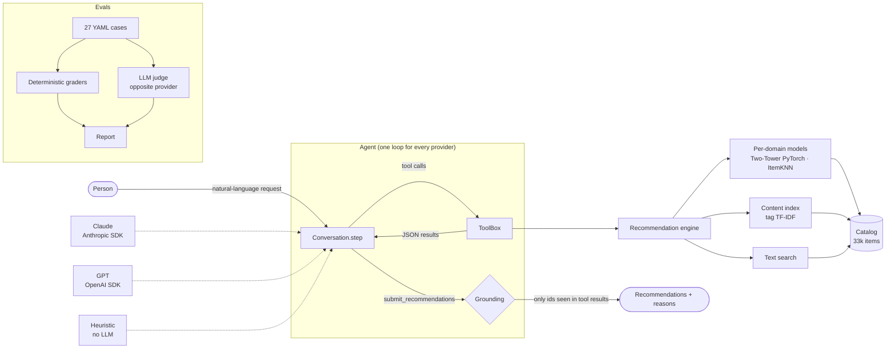

<div align="center">

# Repertório

**Book, movie, TV series and music recommendations with LLMs, tool use, PyTorch ranking models and an evals framework.**

[](https://github.com/ceciliatv/repertorio/actions/workflows/ci.yml)


[](LICENSE)

[Versão em português](README.md)

</div>

---

You say "I read *Dune* and *Neuromancer*, I want a TV series", and Repertório answers with real series from its catalog, each one with a reason. Behind that:

- a **unified catalog** of 33k items built from four public datasets;
- **PyTorch ranking models** compared against baselines in a reproducible offline evaluation;
- a **tool-using agent** that runs on **Claude (Anthropic)** or **GPT (OpenAI)** through the same loop, and can only recommend what its tools returned;
- an **evals framework** with deterministic graders and an LLM judge to measure answer quality;
- all of it built with **spec-driven development**: [every part started as a spec](docs/specs/) (specs are in Portuguese).

```text
$ repertorio recommend --like "book:Dune" --like "book:Neuromancer" --like "book:13" --domain series --k 5

series para quem curtiu: Dune, Neuromancer, 1984
 series:41414  For All Mankind      2019  drama, science-fiction  tags em comum com seu perfil: science-fiction (a partir do que você curtiu em livro)
 series:42846  Dune: Prophecy       2024  drama, science-fiction  ...
 series:635    Ascension            2014  drama, science-fiction  ...
 series:37781  The Peripheral       2022  drama, science-fiction  ...
 series:16579  The Handmaid's Tale  2017  drama, science-fiction  ...
```

<sub>Real engine output, no LLM involved. The profile only has books and the request is for series, which have no public interactions: cold start on both sides, solved through shared tags. The CLI speaks Portuguese.</sub>

## Architecture



## How it works

**1. Unified catalog.** Goodbooks-10k (10,000 books, 6M ratings), MovieLens `ml-latest-small` (4,978 movies, 100k ratings), TVMaze (6,526 series, content only) and HetRec 2011 Last.fm (11,695 artists, 92k user-artist pairs). Tag normalization merges synonyms (`sci-fi` → `science-fiction`), drops shelf and ownership tags (`to-read`, `owned`, `seen-live`) and author-name tags, leaving 145 tags shared by at least three domains. Those shared tags are what make cross-domain recommendations possible.

**2. Ranking models.** Every model takes a **history** (a list of items) instead of a user id, so all three are **inductive**: they work for people who were not in training, which is exactly the person talking to the agent.
- Popularity (mandatory baseline).
- ItemKNN: item-item cosine on the binary matrix, computed in blocks and pruned to 200 neighbors.
- **Two-Tower (PyTorch):** user tower = mean of history embeddings + residual MLP; item tower = embedding + bias. Full softmax over the catalog with the other history items masked, and random history lengths during training so it handles 1- or 2-item profiles.

**3. Engine and cold start.** For a target domain, the engine blends three signals converted to percentiles: `a · collaborative + (1 − a) · content + 0.05 · popularity`, with `a = n / (n + 3)` and `n` = liked items **in that domain**. No history in the domain (or series, which have no interactions) means content from the whole profile, across domains. An empty profile falls back to popularity. Every item comes with reasons.

**4. Tool-using agent.** Seven tools: `search_catalog`, `get_item_details`, `get_user_profile`, `recommend_for_user`, `find_similar`, `update_profile` and the terminal `submit_recommendations`, which is how the answer comes out structured.
- **One loop for every provider:** `AnthropicProvider` (Messages API), `OpenAIProvider` (Chat Completions function calling), `HeuristicProvider` (rules, no LLM) and `ScriptedProvider` (tests). The evals compare models, not implementations.
- **Grounding:** the `ToolBox` records every `item_id` seen in a tool result; any other id (made up or "remembered" by the model) is dropped and counted as a hallucination.
- **Validation:** arguments go through Pydantic; errors become error `tool_result`s the model can fix.
- **Safety:** tool results and quoted text are treated as data; there are eval cases for prompt injection and prompt leaking.
- **Claude specifics:** `claude-opus-5-5` by default, configurable `effort`, automatic prompt caching, server-side refusal fallback and `stop_reason == "refusal"` handling. No forced `tool_choice` (Anthropic's newest models reject it): the prompt asks for `submit_recommendations` and the loop checks for it.

**5. Evals.** [27 cases](evals/cases/recommendation.yaml) in six categories: personalization, cross-domain, constraints, cold start, clarification and robustness. Graders: `structured`, `grounded`, `domain`, `count`, `constraints`, `tool_use`, `relevance_tags`, `clarification`, `safety`, plus an optional **LLM judge** (relevance, personalization, explanation quality, 1–5) where the **opposite provider** judges, to reduce self-preference bias. A case passes when every applicable check grader is 1.0 and `relevance_tags` ≥ 0.5. The runner shows how many paid calls it will make and asks for confirmation.

## Results

### Offline model evaluation

Full ranking over the domain catalog (no negative sampling), history items masked. **`new-users` protocol** (20% of users held out of training; half of their history is input, the other half is the target), which is the agent's scenario:

| Domain | Model | HR@10 | Recall@20 | NDCG@10 | Coverage@10 |
|---|---|---:|---:|---:|---:|
| Books | Popularity | 0.592 | 0.140 | 0.187 | 0.3% |
| | ItemKNN | 0.940 | 0.324 | 0.435 | 13.1% |
| | **Two-Tower** | **0.960** | **0.359** | **0.481** | **28.1%** |
| Movies | Popularity | 0.725 | 0.206 | 0.234 | 0.8% |
| | **ItemKNN** | **0.858** | **0.299** | **0.330** | 4.6% |
| | Two-Tower | 0.800 | 0.285 | 0.291 | **15.0%** |
| Music | Popularity | 0.558 | 0.123 | 0.159 | 0.4% |
| | **ItemKNN** | 0.936 | 0.289 | **0.413** | 9.4% |
| | Two-Tower | **0.944** | **0.292** | 0.399 | **27.4%** |

Two-Tower clearly wins on books (the largest domain) and gives 2–3× more **catalog coverage** everywhere; with little data (movies, music) ItemKNN ties or wins on NDCG. The engine therefore **picks the model per domain** by `new-users` NDCG@10. Full reports: [`offline_new-users.md`](reports/offline_new-users.md), [`offline_loo.md`](reports/offline_loo.md).

### Agent evals

| Provider | Pass rate | grounded | domain | constraints | relevance_tags | Cross-domain |
|---|---:|---:|---:|---:|---:|---:|
| Heuristic (no LLM, baseline) | 0.85 | 1.00 | 0.98 | 1.00 | 0.91 | 0.40 |
| Claude (`claude-opus-5-5`) | *pending* | | | | | |
| GPT (`gpt-5`) | *pending* | | | | | |

Only measured numbers are published. The LLM rows are filled by running `repertorio eval llm --provider anthropic --judge auto` (or `openai`) with an API key. The baseline does well on "easy" cases and fails where the sentence must be understood ("I read Dune and loved it, recommend similar series"): that is where the LLM has to show its value.

## Running locally

```bash
git clone https://github.com/ceciliatv/repertorio.git && cd repertorio
python -m venv .venv && source .venv/bin/activate
pip install -e ".[dev]"

repertorio data download        # ~240 MB into data/raw
repertorio data build
repertorio train                # ~5 min on CPU
repertorio eval offline --protocol all
repertorio eval llm --provider heuristic --yes

cp .env.example .env            # add ANTHROPIC_API_KEY and/or OPENAI_API_KEY
repertorio chat --provider anthropic
repertorio serve                # http://127.0.0.1:8000/docs

pytest                          # 73 tests, no network, no API key
```

## Limitations

- Series have no public interactions, so they are recommended by content only.
- User tags are noisy (one troll tag, `better-than-radiohead`, made a search for "Radiohead" return LazyTown until search started weighting titles).
- Music is the weakest cross-domain bridge; it relies on mood tags.
- `relevance_tags` is a coarse proxy; the LLM judge exists for that.
- The real providers have not been run against the APIs in this repository yet (no key). They follow the SDK docs and were checked against the installed SDK signatures; the loop is tested with the scripted provider.

## Data and licenses

Code is MIT. Data is **not** in the repository; `repertorio data download` fetches each source. MovieLens and HetRec Last.fm: GroupLens Research, research use, no redistribution. Goodbooks-10k: CC BY-SA 4.0. TVMaze: public API data, CC BY-SA.

---

Built by **Maria Cecília Torres Vianna** · [LinkedIn](https://linkedin.com/in/cecília-vianna-708a67285)
