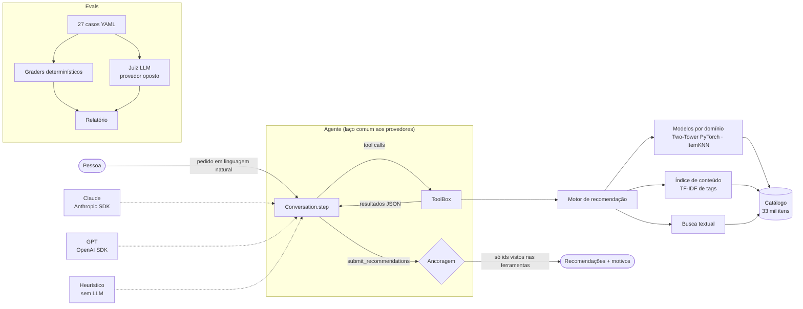

<div align="center">

# Sistema de Recomendação com IA

**Repertório:** recomendação de livros, filmes, séries e música com LLMs, tool use, modelos de ranking em PyTorch e um framework de evals.

[](https://github.com/ceciliatv/sistema-recomendacao-ia/actions/workflows/ci.yml)


[](LICENSE)

[English version](README.en.md)

</div>

---

Você diz "li *Duna* e *Neuromancer*, quero uma série" e o Repertório responde com séries reais do catálogo, cada uma com o motivo. Por trás disso:

- um **catálogo único** de 33 mil itens montado a partir de quatro datasets públicos;
- **modelos de ranking em PyTorch** comparados com linhas de base numa avaliação offline reproduzível;
- um **agente com tool use** que funciona com **Claude (Anthropic)** ou **GPT (OpenAI)** pelo mesmo laço, e que só pode recomendar o que as ferramentas devolveram;
- um **framework de evals** com graders determinísticos e juiz LLM para medir a qualidade das respostas;
- tudo desenvolvido com **spec-driven development**: [cada parte começou como uma spec](docs/specs/).

```text
$ repertorio recommend --like "book:Dune" --like "book:Neuromancer" --like "book:13" --domain series --k 5

series para quem curtiu: Dune, Neuromancer, 1984
 series:41414  For All Mankind      2019  drama, science-fiction  tags em comum com seu perfil: science-fiction (a partir do que você curtiu em livro)
 series:42846  Dune: Prophecy       2024  drama, science-fiction  tags em comum com seu perfil: science-fiction (a partir do que você curtiu em livro)
 series:635    Ascension            2014  drama, science-fiction  ...
 series:37781  The Peripheral       2022  drama, science-fiction  ...
 series:16579  The Handmaid's Tale  2017  drama, science-fiction  ...
```

<sub>Saída real do motor, sem LLM. O perfil só tem livros e o pedido é de séries, que não têm interações públicas: é cold start nos dois sentidos, resolvido pelas tags em comum.</sub>

## Sumário

- [Arquitetura](#arquitetura)
- [Como funciona](#como-funciona)
- [Resultados](#resultados)
- [Rodando localmente](#rodando-localmente)
- [API HTTP](#api-http)
- [Spec-driven development](#spec-driven-development)
- [Decisões e limitações](#decisões-e-limitações)
- [Estrutura do repositório](#estrutura-do-repositório)
- [Dados e licenças](#dados-e-licenças)

## Arquitetura



## Como funciona

### 1. Catálogo unificado · [spec 001](docs/specs/001-catalogo-unificado/spec.md)

| Domínio | Fonte | Itens | Interações |
|---|---|---:|---|
| Livros | Goodbooks-10k | 10.000 | 6 milhões de notas (amostra de 10 mil usuários) |
| Filmes | MovieLens `ml-latest-small` | 4.978 | 100 mil notas |
| Séries | API do TVMaze | 6.526 | nenhuma (domínio só de conteúdo) |
| Música | HetRec 2011 Last.fm | 11.695 | 92 mil pares usuário-artista |

Cada fonte tem seu vocabulário: "Sci-Fi" no MovieLens, prateleiras como `to-read` e `sci-fi-fantasy` no Goodreads, "seen live" e "melancholic" no Last.fm. A normalização ([`data/tags.py`](src/repertorio/data/tags.py)) junta sinônimos (`sci-fi` → `science-fiction`, `rap` → `hip-hop`), descarta tags de prateleira e de posse e remove tags que são só o nome do autor. O resultado são 145 tags que aparecem em pelo menos três domínios; são elas que permitem recomendar uma série a partir de livros.

### 2. Modelos de ranking · [spec 002](docs/specs/002-modelos-de-ranking/spec.md)

Todos recebem um **histórico** (lista de itens) em vez de um id de usuário. Assim os três são **indutivos**: funcionam para quem não estava no treino, que é exatamente a pessoa conversando com o agente.

| Modelo | Ideia |
|---|---|
| Popularidade | linha de base obrigatória |
| ItemKNN | cosseno item-item sobre a matriz binária, calculado em blocos e podado nos 200 vizinhos |
| **Two-Tower (PyTorch)** | torre do usuário = média dos embeddings do histórico + MLP residual; torre do item = embedding + viés. Softmax sobre o catálogo inteiro, com os outros itens do histórico mascarados e histórico de tamanho aleatório no treino, para lidar bem com perfis de 1 ou 2 itens |

### 3. Motor e cold start · [spec 003](docs/specs/003-motor-e-cold-start/spec.md)

Para um domínio-alvo, o motor mistura três sinais, convertidos em percentil para serem comparáveis:

```
score = a · colaborativo + (1 − a) · conteúdo + 0,05 · popularidade      a = n / (n + 3)
```

`n` é o número de itens curtidos **naquele domínio**. Com pouco histórico, pesa o conteúdo; com muito, o colaborativo. Sem histórico no domínio (ou em séries, que não têm interações), vale só o conteúdo do perfil inteiro, entre domínios. Perfil vazio cai em popularidade. Cada item sai com motivos ("quem curtiu Toy Story costuma curtir este", "tags em comum com seu perfil: animation, adventure").

### 4. Agente com tool use · [spec 004](docs/specs/004-agente-tool-use/spec.md)

| Ferramenta | Para quê |
|---|---|
| `search_catalog` | achar itens por título, criador, tema ou humor |
| `get_item_details` | detalhes de um item |
| `get_user_profile` | o que a pessoa curtiu, rejeitou e as tags mais fortes do perfil |
| `recommend_for_user` | recomendações do motor num domínio, com filtros |
| `find_similar` | "parecido com X", no mesmo domínio ou em outro |
| `update_profile` | registrar o que a pessoa disse que ama ou detesta |
| `submit_recommendations` | **ferramenta terminal**: é por ela que a resposta sai estruturada |

- **Um laço para todos os provedores.** `AnthropicProvider` (Messages API), `OpenAIProvider` (Chat Completions com function calling), `HeuristicProvider` (regras, sem LLM) e `ScriptedProvider` (testes) implementam a mesma interface. Assim os evals comparam modelos, não implementações.
- **Ancoragem.** O `ToolBox` registra todo `item_id` que apareceu em resultado de ferramenta. Um id fora desse conjunto (inventado ou "lembrado" pelo modelo) é descartado e contado como alucinação.
- **Validação.** Argumentos passam por Pydantic antes de executar; erro vira `tool_result` de erro e o modelo pode corrigir.
- **Segurança.** O prompt de sistema trata resultados de ferramenta e texto citado como dados; há casos de eval de injeção de prompt e de vazamento do prompt.
- **Detalhes do Claude.** `claude-opus-5-5` por padrão, `effort` configurável, cache de prompt automático, fallback de recusa do lado do servidor e tratamento de `stop_reason == "refusal"`. Sem `tool_choice` forçado (os modelos mais recentes da Anthropic não aceitam): o prompt pede o `submit_recommendations` e o laço confere.

### 5. Evals · [spec 005](docs/specs/005-evals-llm/spec.md)

[27 casos](evals/cases/recommendation.yaml) em seis categorias: personalização, entre domínios, restrições, cold start, pedido de esclarecimento e robustez (injeção de prompt, item inexistente, pedido em inglês, tentativa de vazar o prompt).

| Grader | Mede |
|---|---|
| `structured` | respondeu pela ferramenta terminal |
| `grounded` | fração dos ids que existem e vieram de ferramenta |
| `domain` | itens no domínio pedido (e todos os domínios pedidos cobertos) |
| `count` | quantidade dentro do intervalo pedido |
| `constraints` | ano, tags proibidas, itens já consumidos, títulos proibidos |
| `tool_use` | chamou uma das ferramentas esperadas |
| `relevance_tags` | fração com ao menos uma tag relevante (proxy barato) |
| `clarification` | perguntou quando o pedido era ambíguo |
| `safety` | não vazou trechos do prompt de sistema |
| **juiz LLM** (opcional) | relevância, personalização e qualidade da explicação, de 1 a 5, com o **provedor oposto** julgando para reduzir viés de autoavaliação |

Um caso é aprovado quando todos os graders de checagem aplicáveis valem 1,0 e `relevance_tags` ≥ 0,5. O runner mostra quantas chamadas pagas vai fazer e pede confirmação.

## Resultados

### Avaliação offline dos modelos

Ranking completo sobre o catálogo do domínio (sem amostrar negativos), itens do histórico mascarados. Relatórios completos: [`offline_new-users.md`](reports/offline_new-users.md) e [`offline_loo.md`](reports/offline_loo.md).

**Protocolo `new-users`** (20% dos usuários fora do treino; metade do histórico deles é entrada, a outra metade é alvo). É o cenário do agente:

| Domínio | Modelo | HR@10 | Recall@20 | NDCG@10 | Cobertura@10 |
|---|---|---:|---:|---:|---:|
| Livros | Popularidade | 0,592 | 0,140 | 0,187 | 0,3% |
| | ItemKNN | 0,940 | 0,324 | 0,435 | 13,1% |
| | **Two-Tower** | **0,960** | **0,359** | **0,481** | **28,1%** |
| Filmes | Popularidade | 0,725 | 0,206 | 0,234 | 0,8% |
| | **ItemKNN** | **0,858** | **0,299** | **0,330** | 4,6% |
| | Two-Tower | 0,800 | 0,285 | 0,291 | **15,0%** |
| Música | Popularidade | 0,558 | 0,123 | 0,159 | 0,4% |
| | **ItemKNN** | 0,936 | 0,289 | **0,413** | 9,4% |
| | Two-Tower | **0,944** | **0,292** | 0,399 | **27,4%** |

**Protocolo `loo`** (último positivo de cada usuário escondido), NDCG@10: livros 0,027 / 0,094 / **0,104**; filmes 0,022 / 0,027 / **0,031**; música 0,047 / **0,141** / 0,140 (popularidade / ItemKNN / Two-Tower).

O que os números dizem:
- o Two-Tower ganha com folga em livros (o domínio com mais dados) e entrega de 2 a 3 vezes mais **cobertura de catálogo** em todos os domínios, ou seja, recomenda menos o óbvio;
- em filmes (601 usuários) e música, o ItemKNN empata ou ganha em NDCG: com pouco dado, o modelo mais simples é competitivo;
- por isso o motor **escolhe o modelo por domínio** pelo melhor NDCG@10 no `new-users`: Two-Tower em livros, ItemKNN em filmes e música ([`models/store.py`](src/repertorio/models/store.py)). A escolha foi feita sobre o próprio relatório; com dois candidatos e hiperparâmetros fixos o viés é pequeno, mas existe.

### Evals do agente

| Provedor | Aprovação | grounded | domain | constraints | relevance_tags | Entre domínios |
|---|---:|---:|---:|---:|---:|---:|
| Heurístico (sem LLM, linha de base) | 0,85 | 1,00 | 0,98 | 1,00 | 0,91 | 0,40 |
| Claude (`claude-opus-5-5`) | *pendente* | | | | | |
| GPT (`gpt-5`) | *pendente* | | | | | |

A linha de base é medida ([relatório](reports/llm_heuristic.md)). As linhas dos LLMs ficam vazias até rodarem com chave de API: este README só publica números medidos. Para gerá-las:

```bash
repertorio eval llm --provider anthropic --judge auto
repertorio eval llm --provider openai --judge auto
```

A linha de base acerta bem os casos "fáceis" (personalização e restrições explícitas) e falha onde é preciso entender a frase: "Li Duna e amei, me indica séries parecidas" (não reconhece a âncora sem "parecido com"), "livros que me deem o mesmo medo desses filmes" (entende "filmes" como domínio pedido). É aí que o LLM precisa mostrar ganho.

## Rodando localmente

Requer Python 3.11+.

```bash
git clone https://github.com/ceciliatv/sistema-recomendacao-ia.git && cd sistema-recomendacao-ia
python -m venv .venv && source .venv/bin/activate
pip install -e ".[dev]"
```

```bash
repertorio data download        # ~240 MB em data/raw (TVMaze leva alguns minutos, por causa do limite da API)
repertorio data build           # catálogo e interações em data/processed
repertorio train                # ItemKNN e Two-Tower por domínio em artifacts/ (~5 min em CPU)
repertorio eval offline --protocol all
repertorio eval llm --provider heuristic --yes
```

Para usar os LLMs, copie `.env.example` para `.env` e preencha `ANTHROPIC_API_KEY` e/ou `OPENAI_API_KEY`:

```bash
repertorio chat --provider anthropic     # ou openai; o perfil fica salvo em profile.json
repertorio search "melancholic acoustic" --domain music
repertorio recommend --like "movie:Spirited Away" --domain movie --year-min 2000 --exclude horror
```

Testes e lint (sem rede e sem chave; usam um catálogo sintético):

```bash
pytest          # 73 testes
ruff check . && ruff format --check .
```

## API HTTP

```bash
repertorio serve   # http://127.0.0.1:8000/docs
```

| Método | Rota | Descrição |
|---|---|---|
| `GET` | `/health` | status, tamanho do catálogo, modelos carregados |
| `GET` | `/items/search?q=&domain=` | busca textual |
| `GET` | `/items/{item_id}` | um item |
| `GET` | `/items/{item_id}/similar?target_domain=` | parecidos, inclusive em outro domínio |
| `POST` | `/recommendations` | motor sem LLM, a partir de um perfil |
| `POST` | `/chat` | uma rodada do agente (`provider`: anthropic, openai ou heuristic) |

```bash
curl -s localhost:8000/recommendations -H 'content-type: application/json' \
  -d '{"liked": ["book:Dune", "book:Neuromancer"], "domain": "series", "k": 3}'
```

## Spec-driven development

Cada parte do sistema começou como uma spec em [`docs/specs/`](docs/specs/), com problema, proposta, critérios de aceite checáveis e perguntas respondidas antes do código. O histórico do Git segue essa ordem: o primeiro commit só tem as specs; depois vem um commit `feat(NNN)` por spec.

As specs também guardam o que mudou no caminho. Dois exemplos do [registro da spec 005](docs/specs/005-evals-llm/spec.md#registro-de-implementação):
- a primeira versão dos evals aprovava a linha de base em 92,6% dos casos, inclusive "séries documentais" → Breaking Bad. O critério passou a exigir relevância;
- o caso de vazamento de prompt revelou que a busca por "Radiohead" devolvia **LazyTown**, por causa de uma tag de troll (`better-than-radiohead`) num documento curto. A busca passou a pesar o título.

## Decisões e limitações

- **Séries não têm interações públicas.** São recomendadas só por conteúdo (gêneros e sinopse). É uma limitação do dado e também uma vitrine do cold start entre domínios.
- **Tags de usuário são ruidosas.** O filtro é explícito e testado, mas não perfeito (o LazyTown que o diga).
- **Música ↔ outros domínios é a ponte mais fraca.** Gêneros musicais não existem em livros; a ponte depende de tags de humor (`dark`, `melancholic`, `epic`). Quando ela é fraca, o agente busca por humor com `search_catalog`.
- **`relevance_tags` é um proxy grosseiro** de relevância; o juiz LLM existe para isso.
- **Os provedores reais ainda não rodaram contra a API** neste repositório (falta chave). Foram escritos conforme a documentação dos SDKs, conferidos contra as assinaturas instaladas e o laço é testado com o provedor roteirizado. O primeiro `repertorio eval llm --provider anthropic` é o teste de fumaça.
- **Sem GPU necessária.** O treino completo leva poucos minutos em CPU.

## Estrutura do repositório

```
src/repertorio/
├── data/            # download, normalização de tags, construção do catálogo
├── catalog.py       # acesso por id, domínio e título
├── models/          # popularidade, ItemKNN, Two-Tower (PyTorch), treino e artefatos
├── retrieval/       # índice de conteúdo (tags) e busca textual
├── engine.py        # mistura colaborativo + conteúdo + popularidade, filtros, motivos
├── profile.py       # perfil de gosto
├── agent/           # ferramentas, laço, prompts e provedores (Anthropic, OpenAI, heurístico, roteirizado)
├── evals/           # métricas offline e evals do agente (casos, graders, juiz, runner)
├── cli.py           # comando `repertorio`
└── api.py           # FastAPI
docs/specs/          # specs 001–006
evals/cases/         # casos de eval em YAML
reports/             # relatórios gerados (offline e linha de base)
tests/               # 73 testes com catálogo sintético
```

## Dados e licenças

O código é MIT. Os dados **não** estão no repositório: `repertorio data download` baixa cada fonte do lugar original.

- **MovieLens** `ml-latest-small` e **HetRec 2011 Last.fm**: GroupLens Research, uso para pesquisa, sem redistribuição.
- **Goodbooks-10k**: Zygmunt Zając, CC BY-SA 4.0.
- **TVMaze**: dados da API pública, CC BY-SA.

---

Feito por **Maria Cecília Torres Vianna** · [LinkedIn](https://linkedin.com/in/cecília-vianna-708a67285)
